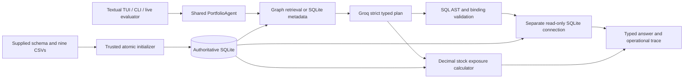

# PL Capital — Portfolio Workspace

A terminal-first assessment implementation with four working components: natural-language **SQL Query Tool**, deterministic **Exposure Calculator**, **Groq Portfolio Agent**, and an independent **Ground Truth Evaluator**. SQLite owns every financial answer. Optional local FalkorDBLite supplies relationship context; it never performs the financial arithmetic.

The interface is independently implemented in Python/Textual, inspired by OpenCode's chat, composer, sidebar and inspectable activity patterns. No OpenCode code/assets are copied and no affiliation is claimed. This is descriptive analysis of supplied historical data, not a trading system or personalized investment adviser.

## Quick start

> **Prerequisites:** Python 3.12–3.14, [uv](https://docs.astral.sh/uv/getting-started/installation/), this private repository, and a Groq API key configured privately. `.python-version` selects Python 3.13; uv can provision it. Graph dependencies are optional.
>
> **One-line run command, from the repository root after configuration:**
>
> ```sh
> uv run pl-capital
> ```

First-time macOS/Linux setup:

```sh
git clone https://github.com/rachitkothadia/PL-Capital-Round-2.git
cd PL-Capital-Round-2
cp .env.example .env
chmod 600 .env
# Edit .env locally: replace only the dummy GROQ_API_KEY value.
uv sync --locked
uv run pl-capital doctor
uv run pl-capital
```

First-time Windows PowerShell setup:

```powershell
git clone https://github.com/rachitkothadia/PL-Capital-Round-2.git
Set-Location PL-Capital-Round-2
Copy-Item .env.example .env
notepad .env  # Enter your private Groq key, then save and close.
uv sync --locked
uv run pl-capital doctor
uv run pl-capital
```

Alternatively set `GROQ_API_KEY` in your shell/session. Do not paste a real key into scripts, screenshots, Git or issue reports. `.env` is ignored; environment values take precedence. No OpenAI/Gemini API key, Docker, cloud database or hosted vector service is used. The `openai/` prefix in GPT-OSS model names is a **Groq model identifier**, not an OpenAI API integration.

On first use the supplied schema and nine CSVs are imported into a platform-appropriate local cache. Writes are restricted to trusted initialization. Normal questions never replace an existing database. If CSVs change, run `uv run pl-capital init-db --rebuild` explicitly; a failed rebuild preserves the previous database.

## Commands

```sh
uv run pl-capital --help
uv run pl-capital doctor --json
uv run pl-capital init-db
uv run pl-capital graph status --json
uv run pl-capital ask "How many portfolios do we have in total?"
uv run pl-capital ask "Show sector exposures for international equity" --trace
uv run pl-capital ask "Show sector exposures for Balanced Portfolio" --json
uv run pl-capital ask "List all active portfolios" --model openai/gpt-oss-20b
uv run pl-capital eval --live --report reports/evaluation.json
uv run pytest -q
uv run ruff check .
uv build
```

Default model: `openai/gpt-oss-120b`; supported alternative: `openai/gpt-oss-20b`. Set `GROQ_MODEL` or use `--model`. AI interpretation can vary even at temperature zero. Planning uses a nonstreaming strict JSON schema; actual operation events provide progress and audit evidence. Missing keys and provider errors produce safe errors; they never substitute canned answers.

`--json` emits a typed answer including intent, tool, result, proposed/executed SQL, bound parameters, warnings, error, timings and trace. Noninteractive failures return a nonzero exit status. The no-argument TUI requires an interactive terminal; redirected/CI sessions should use `ask` or `eval`.

## Terminal controls

| Control | Behavior |
|---|---|
| Enter | Send the composer to the shared agent |
| Ctrl+J / Shift+Enter | Insert a newline |
| Ctrl+P | Command palette |
| Ctrl+T / `/trace` | Expand/collapse actual execution events |
| `/help`, F1 | Working shortcuts and commands |
| `/new`, Ctrl+L | Fresh session and follow-up context |
| `/clear`, `/sessions` | Clear current context / list this run's sessions |
| `/model [model ID]` | Inspect/switch the actual Groq planner |
| `/graph` | Actual backend and fallback reason |
| `/eval` | Background live evaluation of all supplied questions |
| `/quit`, `:q`, Ctrl+Q | Exit |

The sidebar hides below 100 columns; the inspector hides below 140. Session history is bounded and in memory only; it ends on exit. Trace cards show selected tool, retrieved graph evidence/queries, schema, proposed SQL, validation, execution, formulas and verification. They contain operational records, never private model reasoning. SQL copy also exports a private local cache file; clipboard support depends on the terminal (macOS Terminal does not support Textual's clipboard protocol). Use the export/manual selection fallback when needed.

## Optional local GraphRAG

Core installation has no native graph dependency. Native Windows always has the complete SQLite path.

```sh
# Supported macOS/Linux only. macOS requires an existing libomp installation.
uv run --extra graph pl-capital graph status --json
uv run --extra graph pl-capital
```

If needed, install `libomp` using your trusted system package manager before enabling the graph extra. No privileged install is performed by the application. `GRAPH_BACKEND=auto` tries the optional backend and visibly falls back. `off` disables it. Explicit `lite` reports actionable prerequisites and retains the working SQLite analytics path on failure.

The real graph contains `Table → HAS_COLUMN → Column`, foreign-key `REFERENCES`, `Portfolio → HOLDS → Security → IN_SECTOR → Sector`. Trusted parameterized ingestion uses MERGE, snapshot fingerprints, completion markers and locks. Question terms select real entities, holdings, schema and joins through fixed read-only Cypher traversals. Actual queries/bindings are recorded. An outage switches retrieval to introspected SQLite metadata. This is relationship-based GraphRAG, not embeddings or vector search. [Graph details and native tests](docs/graph.md).

## Architecture



The agent can return `sql_query`, `exposure_calculator`, `clarification_needed` or `out_of_scope`. All SQL is genuinely generated by Groq. The production planner never imports the ground-truth file. Model arithmetic never supplies financial results. One bounded SQL correction is allowed; transient SDK retries are capped. [Architecture and boundaries](docs/architecture.md).

## Data and exposure definitions

Snapshot integrity checks: **13 portfolios, 30 securities (25 stocks/5 bonds), 10 sectors, 95 holdings, 24 transactions, 13 benchmarks, 330 historical prices, 44 performance rows, 44 risk rows**. Performance and risk cover only four portfolios. Total Stock Market Index Fund recorded weights total **0.98**; missing weights are not fabricated. Some sectors have no securities. Historical price rows span 2023-09-25 through 2023-10-09; the separate security current_price fields remain supplied snapshot values.

For each sector of a selected portfolio, only `asset_type='Stock'` contributes:

- **Whole-portfolio equity contribution (%)** = `SUM(sector stock current_weight) × 100`.
- **Equity-normalized exposure (%)** = `SUM(sector stock current_weight) / SUM(all stock current_weight) × 100`.

Both views are always labeled. A mixed stock/bond portfolio's first view can total less than 100%; its second view totals approximately 100% for positive equity weights. Equity/bond/recorded totals, stock count, bond exclusion count and coverage warnings are returned. Empty-equity portfolios are an explicit informative result. Invalid, negative, excessive or nonfinite weights, missing sector mappings and duplicate holdings fail safely.

Technology market-value percentages (assessment Q7) instead use `quantity × current_price` with **all holdings' market value** in the denominator. The displayed denominator makes the result auditable. Diversification metrics count distinct **stock sectors**, but their separate holding-count denominator includes bonds (Q8). Stored `total_aum`, holding market value and stored `cost_basis` remain distinct. [Detailed methodology](docs/methodology.md).

## Evaluation and verification

`eval --live` calls the real agent for every supplied question, resets conversation context between questions, and independently executes the supplied SQL references. Exposure references use separate SQL aggregation, not the production Decimal calculator. Comparison checks routing, shape, complete row counts, duplicates, meaningful ordering and numeric precision. It permits equivalent SQL aliases; it never weakens missing-column checks. The fixture is preserved unchanged.

Offline tests explicitly inject mock planners and label mocked evaluator reports. They test mechanics and failure paths and are **not** live AI accuracy. Machine-readable live reports stay local/ignored. See [verified release results](docs/release-report.md) for actual counts, failures investigated, final live accuracy, native graph operation and commit/push evidence.

Security tests exercise chained SQL, writable CTEs, DDL/DML, PRAGMA/ATTACH, system tables, unsafe functions, unknown columns, injection filters, output/runtime budgets, malformed manifests, atomic rollback, ambiguous names, zero equities, graph outages, provider failures and secret-safe errors. Textual Pilot tests exercise composer keys, resizing, traces, copy/export, evaluation dispatch and error states.

## Security and configuration

SQL defenses are layered: SQLite-dialect AST validation; one read-only SELECT/CTE; schema/table/column/function allowlists; named scalar bindings; independently opened URI `mode=ro`; `query_only`; SQLite authorizer; disabled extension loading; progress/time/step limits; cell/result/row/input/context budgets. Arbitrary Python/shell execution and user-supplied Cypher are not application tools. Audit display checks request corrected ratio plans from Groq rather than rewriting generated SQL or injecting reference answers.

Configuration: `GROQ_API_KEY`, `GROQ_MODEL`, `GRAPH_BACKEND`, `PL_CAPITAL_DATA_DIR` (directory containing schema/data/reference), and `PL_CAPITAL_CACHE_DIR`. Defaults use platformdirs. Cache files, reports, databases, local master instructions and credentials are excluded from Git. Report/export files use owner-only POSIX modes where supported; Windows inherits the parent directory ACL, so keep custom report/cache directories private. Only bounded question/schema/entity context is sent to Groq; no unrelated connector receives repository data. API errors omit raw requests, response bodies and headers.

## Packaging and project layout

`uv.lock` records reproducible dependency resolution. The wheel includes the nine CSVs, schema, evaluation reference and Textual styles so installed commands can run outside the checkout. Install a locally built wheel with your normal trusted Python installer; configure the key in the current environment or current directory's ignored `.env`. The graph extra remains optional and platform-marked. Neither wheel nor source archive is uploaded to a package registry.

```text
src/pl_capital/   config, database, SQL safety/tool, exposure, graph/retrieval,
                 Groq planner, agent, evaluator, CLI, tui/
tests/           deterministic components, adversarial cases, native graph, Pilot UI
data/            original nine CSVs
docs/            architecture, methodology, capability audit, verification
                 assignment-original/ (unchanged original README/requirements)
```

Dependencies are deliberately small: Groq SDK, Textual/Rich, sqlglot, Pydantic, python-dotenv, platformdirs and filelock. CSV loading uses Python's standard library. pandas, Streamlit, Gemini SDKs and web servers are unnecessary. [Capability/adoption audit](docs/capability-audit.md), [third-party notices](THIRD_PARTY_NOTICES.md).

## Assumptions & limitations

- Historical supplied data only; no live market prices, trading or personal advice.
- AI interpretation and generated SQL can vary. A passing live run is evidence for that run, not a guarantee for every paraphrase/model.
- Incomplete weights and limited risk/performance coverage are disclosed, never filled or silently normalized.
- Optional native GraphRAG has OS/runtime requirements; all quantitative answers retain the SQLite fallback.
- Clipboard transport varies by terminal. Use the private SQL export fallback.
- Conversation history is bounded/in-memory; sessions do not persist across restarts.
- Ambiguous/missing entities require clarification; fixed-income-only funds have no equity-sector breakdown.

## Troubleshooting

`doctor` checks key presence without showing it and does not call Groq. For authentication/403 errors, verify private configuration and permitted model access. For 429/timeouts/5xx, retry later; bounded retries never switch to fake output. For changed/corrupt local databases, inspect source CSVs and use `init-db --rebuild` explicitly. For a graph outage, read `/graph` or `graph status` and use SQLite fallback; enable the reviewed extra only on a supported OS. For noninteractive execution, use `ask --json` instead of the no-argument TUI.
