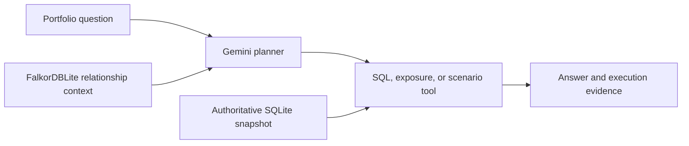

# PL Capital | Portfolio Intelligence Terminal

**Ask in plain language. Explore the answer. Inspect the evidence behind it.**

*Rachit Kothadia · PL Capital Round 2 Technical Assessment*

A portfolio analytics workspace that turns natural-language questions into auditable analysis. It brings a Gemini planner, read-only SQL, deterministic financial tools, and an embedded relationship graph into one interactive terminal.

**10/10 on the official live assessment · 20/20 independently verified advanced references · 480 local tests passed in release verification**

## What I built

| Capability | What it gives the reviewer |
| --- | --- |
| **Natural-language portfolio agent** | A typed Gemini plan routes each request to SQL, exposure analysis, or a market scenario. Follow-up questions can reuse the portfolio context, and ambiguous requests get a clarification. |
| **Auditable SQL analytics** | Explore holdings, transactions, performance, risk, and portfolio comparisons. Inspect the exact executed SQL, its bound parameters, source tables, and validation decisions. |
| **Deterministic exposure calculator** | Measure sector concentration with clearly labeled whole-portfolio and equity-normalized weights. The calculation exposes coverage gaps and how bonds are treated. |
| **Portfolio stress testing** | Apply hypothetical equity-sector and bond shocks. Review portfolio value changes, P&L, returns, sector contributions, and the holding-level arithmetic behind them. The direct calculator also runs without an API key. |
| **Embedded GraphRAG** | FalkorDBLite grounds the planner in portfolio, holding, security, sector, and schema relationships. The app records the graph evidence used and falls back to SQLite metadata when graph context is unavailable. |
| **Independent evaluation** | Run the official questions through the live agent and check each result against an independent reference. A separate challenge suite tests more demanding SQL and financial logic, with failures and inconclusive outcomes reported separately. |

## An interactive terminal built for review

- **Answers first, evidence on demand.** Expand the execution trace to see which tool ran, what data it used, the calculation or SQL it executed, and which checks passed. Assumptions, warnings, and elapsed time are visible alongside the result.
- **Mouse and keyboard navigation.** Click actions, scroll through wide tables with fixed identifier columns, open a full table, and drill into individual records. Scenario details include the sector breakdown for the selected portfolio.
- **Take the evidence with you.** Copy accepted SQL or scenario calculations, save SQL to a file, and export complete bounded results as JSON with their provenance.
- **Responsive while work runs.** Background workers keep the terminal responsive during analysis. The agent skips unnecessary graph lookups, limits the context sent to Gemini, and executes queries and calculations locally. Timings make it possible to see where a request spends its time.

## How an answer earns trust



| Safeguard | Why it matters |
| --- | --- |
| **Read-only execution** | Generated SQL passes statement, schema, and function checks. Bound values, SQLite read-only access, and a database authorizer constrain what can run. |
| **Bounded work** | Query time, execution steps, result size, and graph retrieval have limits. SQL gets one corrective attempt when a check rejects the proposed query or answer. |
| **Financial validation** | Decimal calculators make financial arithmetic repeatable. Independent source checks verify selected SQL metrics, including AUM gaps, equity denominators, and historical decline streaks. |
| **Clear handling of data gaps** | The workspace distinguishes an empty result, missing observations, unsupported analysis, and execution failure. A rejected calculation keeps its reason visible. |
| **Traceable graph context** | Parameterized Cypher retrieves relevant relationships. Snapshot fingerprints detect changes, and the trace records graph usage only when relevant evidence is returned. Health checks exercise a real traversal. |
| **Controlled data exposure** | Live planning sends the question and bounded schema or relationship context to Gemini. Financial execution stays local, credentials are kept out of exports, and diagnostics redact sensitive values. |

## Run the project

Use Python 3.12–3.14 and [uv](https://docs.astral.sh/uv/). For live questions, copy `.env.example` to `.env` and set your own `GEMINI_API_KEY`.

```sh
uv sync --locked
uv run pl-capital doctor --graph
uv run pl-capital
```

The embedded graph runs on supported macOS and Linux environments without Docker. On macOS, install `libomp` if the native loader requires it. Windows uses SQLite for analysis. The supplied data is a historical snapshot. [Graph setup and recovery](docs/graph.md) · [Financial methodology](docs/methodology.md)

## Command reference

| Terminal command | Action |
| --- | --- |
| `/help`, `Ctrl+P` | Open help or the command palette |
| `/new`, `/clear`, `/sessions` | Start a session, reset follow-up context, or inspect session names |
| `/model [model-id]` | Inspect or switch the Gemini planner |
| `/graph` | Inspect native graph health and retrieval evidence |
| `/trace`, `Ctrl+T` | Expand execution evidence |
| `/debug` | Open redacted diagnostics |
| `/copy`, `F6` | Copy the latest accepted SQL or scenario calculation |
| `/export`, `F7` | Export the latest answer and its evidence |
| `/eval` | Run the official live evaluation inside the terminal |
| `/quit`, `:q`, `Ctrl+Q` | Exit the workspace |

| CLI command | Action |
| --- | --- |
| `uv run pl-capital` | Launch the interactive workspace |
| `uv run pl-capital ask "<question>" --trace` | Run a one-shot analysis with its evidence. Use `--json` for structured output. |
| `uv run pl-capital scenario --shock "SECTOR=CHANGE"` | Run a scenario directly. Use `scenario --help` for bond shocks, portfolio filters, and output options. |
| `uv run pl-capital init-db` | Initialize the validated SQLite snapshot. |
| `uv run pl-capital doctor --graph` | Check data, configuration, and native graph readiness. |
| `uv run pl-capital graph status` | Inspect the embedded graph and its retrieval evidence. |
| `uv run pl-capital graph build` | Synchronize the graph with the SQLite snapshot. |
| `uv run pl-capital graph rebuild` | Recover or refresh the derived graph. |
| `uv run pl-capital eval --live --report reports/official.json` | Score the official live assessment and save evidence. |
| `uv run pl-capital challenges --references` | Verify the advanced references offline. |
| `uv run pl-capital challenges --live` | Run the advanced questions through the active model. |
| `uv run pl-capital --help` | View all commands and options. |

## Verification

The advanced reference checks compare SQL and independent Python calculations. A separate saved advanced live run scored **17/20 after semantic rescoring**, with three failures retained. Live outcomes depend on model access and provider limits.

The release was checked on macOS, Linux, and Windows, with native graph checks on macOS and Linux. A packaged build also ran the scenario calculator outside the checkout without a key.

```sh
uv run pytest -q
uv run ruff check .
uv build
```

[Scenario calculations](docs/scenario.md) · [Advanced challenge catalog](docs/advanced-test-questions.md) · [Third-party notices](THIRD_PARTY_NOTICES.md)
